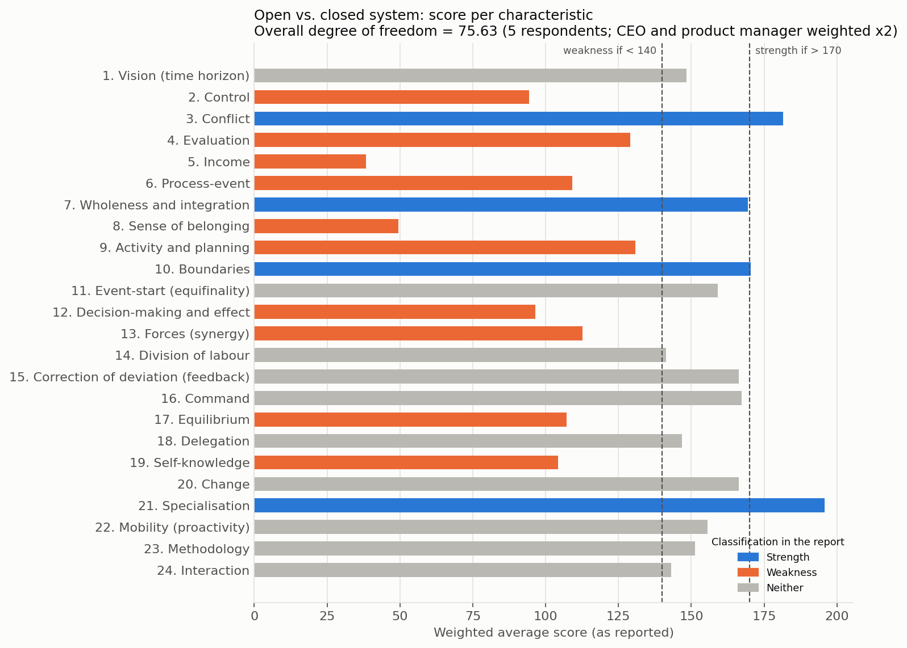
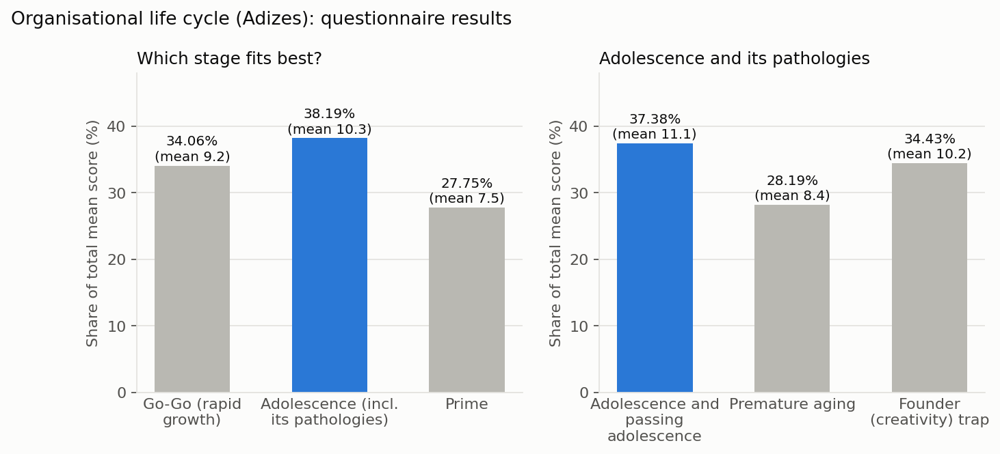
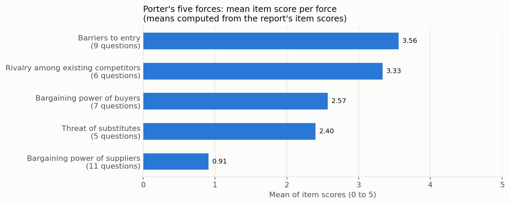
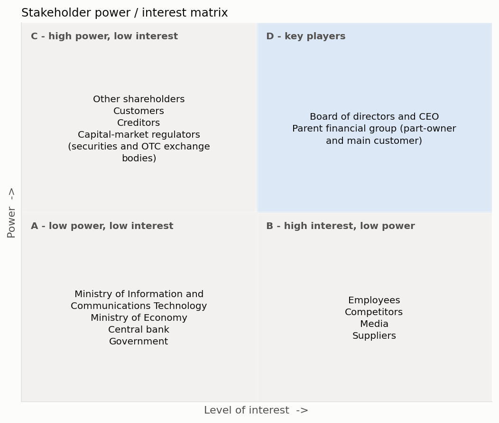
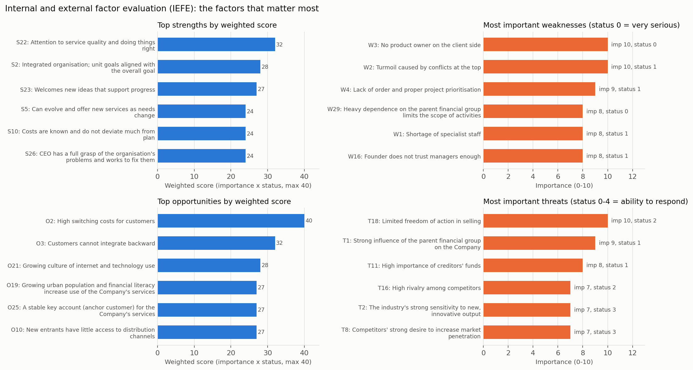
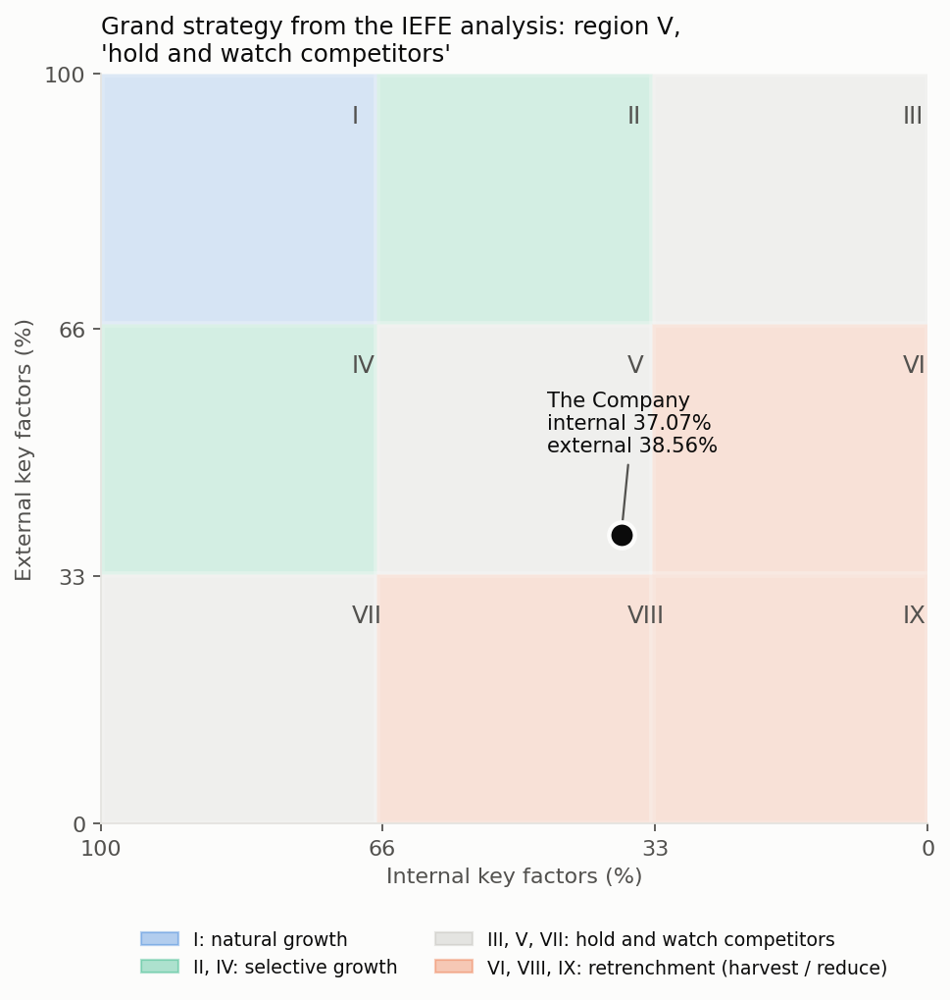

# Strategic Plan for an Iranian Capital-Market Fintech Company: From Diagnosis to Grand Strategy

- **Instructor:** Dr. Sirous
- **Course:** Strategic Planning and Management
- **Department:** Industrial Engineering, Amirkabir University of Technology (Tehran Polytechnic)
- **Author:** Paniz Otaghi (team project)
- **Role:** Business analyst / strategy consultant to the Company

The company's name and identifying details have been withheld for confidentiality.

## At a glance

| | |
|---|---|
| **Client** | A small Iranian fintech company (fewer than 20 staff) that builds capital-market and financial software (crowdfunding, asset-management and investment tools, market dashboards, payment software). A large financial-services group is both a major shareholder and its main customer. |
| **Engagement** | Course strategic-planning engagement (autumn 2024). The team worked with the CEO and product manager, ran staff questionnaires and scored the Company's internal and external factors. |
| **Scope** | Current-state review, organisational diagnosis, industry and macro-environment analysis, stakeholder analysis, vision and mission, grand strategy, and strategy formulation. |
| **Frameworks** | Open vs. closed systems diagnostic, Adizes life cycle, Porter's five forces, PESTEL, critical success factors, stakeholder mapping, internal-external factor evaluation (IEFE) matrix, SWOT/TOWS. |
| **Key findings** | The Company is in the **Adolescence** stage of the life cycle (38.19% of total score, vs. 34.06% Go-Go and 27.75% Prime), with a founder-control problem. Its main weaknesses are founder and board conflict, no client-side product owner, weak project prioritisation, a shortage of specialists and **heavy dependence on the parent financial group**. Its main external advantages are **high customer switching costs** (the only factor to reach the maximum weighted score of 40/40) and a stable key account. |
| **Grand strategy** | IEFE scores of **37.07% internal** and **38.56% external** place the Company in region V of the internal-external matrix: **"hold and watch competitors"**. |
| **Recommended strategies** | Keep key accounts with new services; hire a product owner; reduce the parent group's influence through limited expansion; compete with innovative, diverse products; set a dedicated innovation budget and proper project prioritisation. Long-term vision: **20% market share within 10 years**. |

## Contents

0. [Business situation](#0-business-situation)
1. [Organisational openness (degree of freedom)](#1-organisational-openness-degree-of-freedom)
2. [Life-cycle stage (Adizes)](#2-life-cycle-stage-adizes)
3. [Industry analysis: Porter's five forces](#3-industry-analysis-porters-five-forces)
4. [Macro-environment: PESTEL](#4-macro-environment-pestel)
5. [Critical success factors](#5-critical-success-factors)
6. [Stakeholder analysis](#6-stakeholder-analysis)
7. [Vision, mission and values](#7-vision-mission-and-values)
8. [Grand strategy: IEFE and the internal-external matrix](#8-grand-strategy-iefe-and-the-internal-external-matrix)
9. [Strategy formulation: SWOT / TOWS](#9-strategy-formulation-swot--tows)
- [Recommendations for management](#recommendations-for-management)
- [Skills and methods](#skills-and-methods)
- [Repository structure](#repository-structure)
- [Language note](#language-note)

The full English version of the report, with all tables, is in [`report/Strategic_Plan_EN.md`](report/Strategic_Plan_EN.md).

---

## 0. Business situation

- **What the Company does.** It designs and develops financial and capital-market software in partnership with established firms, and supports fintech start-ups. Products include crowdfunding software, asset-management and smart-investment tools, capital-market management dashboards and payment-gateway software. It also holds payment-facilitation activities in its registered scope.
- **Customers.** Businesses in the IT and capital-market industries. The largest customer is a financial-services group (brokerage, advisory, asset management, investment funds) that is also a shareholder. In this repository it is called **the parent financial group**.
- **People.** 17 experienced staff, mainly programmers and designers. A CEO appointed by the two founders runs the Company. One founder also sits on the parent group's board.
- **Situation at the time of the study.** The Company had become profitable, moved out of the parent group's building and was trying to become fully independent, including buying back the group's shares. This push created conflict between the founders and the CEO. The product-owner role was vacant, and the CEO was covering it.

## 1. Organisational openness (degree of freedom)

A 24-item questionnaire compared the Company with the traits of an "open" system (long-term vision, managed conflict, growth-based evaluation, flexible boundaries) versus a "closed" one. Five staff answered: CEO, product manager, UI designer, front-end and back-end developers. The CEO's and product manager's answers counted double.

- **Overall degree of freedom: 75.63** (CEO 82.09, product manager 80.26, back-end developer 74.85, front-end developer 68.34, UI designer 61.55).
- **Strengths (score > 170):** constructive handling of conflict, a holistic project focus, flexible and expanding boundaries, and hiring for new skills.
- **Weaknesses (score < 140):** income (38.4) and sense of belonging (49.4) scored lowest, followed by control, decision-making, self-knowledge, equilibrium, process stability, synergy, evaluation and planning.

The report links most weaknesses to two causes: the missing product owner and dependence on the parent financial group.



## 2. Life-cycle stage (Adizes)

Interviews with the CEO and product manager pointed to the **Adolescence** stage: a professional CEO, but founders still in control; a shift toward quality and systems; delegation that is not yet stable; and open conflict between decision-makers. Eight questionnaires (Go-Go, Adolescence and its pathologies, Prime) confirmed it.

| Stage | Mean score | Share |
|---|---:|---:|
| Go-Go (rapid growth) | 9.2 | 34.06% |
| **Adolescence** | **10.3** | **38.19%** |
| Prime | 7.5 | 27.75% |

Within Adolescence, the **founder (creativity) trap** scored 34.43%, close to healthy Adolescence (37.38%) and above premature aging (28.19%). High-scoring statements: the founders have opposite risk attitudes; the entrepreneurial founder still controls the Company despite a hired professional manager; and there is a power struggle between that founder and the board.



## 3. Industry analysis: Porter's five forces

The strategy team scored 38 questions (0 to 5) across the five forces.

| Force | Mean item score* | Reading in the report |
|---|---:|---|
| Barriers to entry | 3.56 | High. Protects the Company from new competitors (opportunity), but brand importance and restrictive government rules are threats. |
| Rivalry among competitors | 3.33 | High. Market growth is strong (5/5), but intense rivalry is a major threat to profit. |
| Buyer power | 2.57 | Medium. Customers face high switching costs and cannot integrate backward, but they are few, well informed, and the Company depends on them financially (5/5). |
| Threat of substitutes | 2.40 | Medium. Low risk of substitutes, but competitors want to raise penetration. |
| Supplier power | 0.91 | Very low. Only creditors' funds matter (4/5). |

\*Means computed for this portfolio from the report's item scores.



## 4. Macro-environment: PESTEL

96 macro factors were rated for status and impact. The report concludes that **technological and legal factors have the most impact and environmental factors the least**, which fits a finance-and-technology business.

| | Main opportunities | Main threats |
|---|---|---|
| Political | Deregulation; de-monopolisation and privatisation | Foreign-policy crises that could close foreign markets |
| Economic | Easy public access to the stock exchange and OTC market; improving banking system; better communications | Inflation and falling purchasing power; weak infrastructure |
| Social | Urbanisation and rising financial and technology literacy | Unfavourable geopolitical position |
| Technological | Growing internet, e-commerce and e-marketing use; software-export potential; information security builds trust; copyright protection | - |
| Legal | Improving investment, financial and e-commerce laws; national development plans push technology use | Burdensome rules on financial activity |
| Environmental | Minor | Natural disasters affecting servers (very unlikely) |

## 5. Critical success factors

| Bottleneck | Root cause (report) | Quick fixes (report) |
|---|---|---|
| Shortage of specialist staff | Specialists prefer remote work for foreign companies | Better pay and benefits; hire from a wider area; build the employer brand; train strong staff into specialists |
| Disputes between founders | Interests and frameworks not defined at the start of the partnership | Conflict management; a neutral third party trusted by all founders |
| Poor project prioritisation | No product owner on the client side | Ask the client to name a product owner or product manager |

## 6. Stakeholder analysis

The team mapped 14 stakeholder groups with a sun diagram, a stake-vs-power matrix, a circle model and a power/interest matrix. The **board and CEO** and the **parent financial group** are the only key players (high power, high interest).

- **Biggest threat:** the parent financial group influences all activities as both owner and main customer. Sudden rule changes by the capital-market regulator could, on their own, stop operations.
- **Biggest opportunity:** the group's many subsidiaries all use the Company's services, which gives it a permanent key account.



## 7. Vision, mission and values

- **Vision:** capture **20% market share within 10 years** by shaping an innovative future for financial technology in Iran's capital market.
- **Mission (summary):** make capital-market decisions smarter through software; add new features to every product. Years 1 to 5: new features for the main product (crowdfunding) and groundwork for new products. Years 6 to 10: new products that current customers need but that do not yet exist.
- **Values:** be recognised as part of the country's payment infrastructure; raise innovation in Iran's IT and capital-market ecosystem; provide innovative, advanced IT solutions.

## 8. Grand strategy: IEFE and the internal-external matrix

All findings from sections 1 to 6 were consolidated into **103 factors** (26 strengths, 32 weaknesses, 27 opportunities, 18 threats). Each factor received an importance score (0 to 10) and a status score (0 to 4). Weighted score = importance x status (maximum 40).

| Factors | Sum of weighted scores | Number | Percentage |
|---|---:|---:|---:|
| Internal (S + W) | 860 | 58 | **37.07%** |
| External (O + T) | 694 | 45 | **38.56%** |

Both scores fall in the middle band (33% to 66%), so the Company sits in **region V: "hold and watch competitors"**, meaning it should protect its current market share and position rather than pursue broad growth.

**Decision-relevant factors**

- Top opportunities: high customer switching costs (40), customers cannot integrate backward (32), growing internet and technology use (28), stable key account (27), growing financial literacy (27), new entrants' poor access to distribution (27).
- Most serious weaknesses: no client-side product owner (importance 10, status 0), dependence on the parent group (8, status 0), top-level conflict (10, status 1), poor prioritisation (9, status 1).
- Most important threats: limited freedom of action in selling (importance 10), the parent group's influence (9, status 1), importance of creditors' funds (8, status 1).





Full factor tables: [`data/iefe_factors.csv`](data/iefe_factors.csv) and [section 8 of the full report](report/Strategic_Plan_EN.md#8-grand-strategy-iefe--internal-external-matrix).

## 9. Strategy formulation: SWOT / TOWS

The team reduced the 103 factors to the most prominent 10 strengths, 9 weaknesses, 9 opportunities and 7 threats. They then paired every internal factor with every external factor in a TOWS matrix.

| Cell | Logic | Candidate strategies |
|---|---|---:|
| SO | Use strengths to seize opportunities | 56 |
| ST | Use strengths to counter threats | 53 |
| WO | Fix weaknesses to seize opportunities | 23 |
| WT | Reduce weaknesses to avoid threats | 20 |
| **Total** | | **152** |

Strategies that did not fit the "hold and watch competitors" grand strategy were removed. The final five:

1. **Retain the large, stable key accounts by offering new services.**
2. **Hire a product owner and rely on customers' high switching costs to keep current key accounts.**
3. **Build resistance to the parent financial group's strong influence through a limited expansion of the Company's boundaries.**
4. **Compete more strongly by offering innovative and diverse products.**
5. **Use the industry's strong sensitivity to new output by prioritising projects properly and setting a dedicated budget for innovation.**

## Recommendations for management

Drawn from the report's conclusions across all sections:

1. **Protect the core before expanding.** Follow the "hold" posture: defend current key accounts with new services and quality, and use high switching costs as a buffer.
2. **Fill the product-owner gap.** Hire an experienced product owner, and ask the main client to name one on its side. The report ties control, planning, prioritisation and self-knowledge problems to this gap.
3. **Reduce dependence on the parent financial group step by step.** Sell products that are not built for one group only, widen the partner and customer base, and set independent goals while keeping the relationship.
4. **Resolve the governance conflict.** The report's root cause is that the founders' interests and frameworks were never clearly defined. Use formal conflict management, bring in a third party trusted by all founders, and give managers more authority.
5. **Fund innovation deliberately.** Set a dedicated innovation budget and a clear project-prioritisation process.
6. **Retain and attract talent.** Offer profit or equity sharing after a set period, remote-work days and other benefits; hire from a wider area; build the employer brand; train promising staff into specialists; and run collective-learning sessions.

## Skills and methods

- **Strategic analysis frameworks:** open vs. closed systems diagnostic; Adizes organisational life cycle; Porter's five forces; PESTEL; critical success factors (bottleneck / root-cause analysis); stakeholder mapping (sun diagram, stake-power matrix, circle model, power/interest grid); vision, mission and values drafting; IEFE and internal-external (IE) matrix; nine-cell SWOT / TOWS matrix.
- **Consulting and research methods:** management interviews; staff questionnaire design and weighted scoring by role; factor weighting and rating; synthesis of 100+ factors into a shortlist; strategy screening against a grand strategy.
- **Business analysis:** client situation assessment, ownership and governance analysis, customer-concentration and dependency risk, talent and organisational-design issues, market positioning.
- **Data and tools (portfolio version):** Python (pandas, matplotlib) to re-draw the report's scoring tables and matrices from anonymised CSV data; Markdown documentation.

## Repository structure

```
.
├── README.md                          This summary
├── report/
│   └── Strategic_Plan_EN.md           Full English version of the report (anonymised, condensed)
├── data/                              Anonymised scoring tables from the report
│   ├── degree_of_freedom_items.csv    Open vs. closed system: 24 characteristics x 5 respondents
│   ├── degree_of_freedom_by_respondent.csv
│   ├── life_cycle_questionnaires.csv  Adizes questionnaires: 8 questionnaires, 95 questions
│   ├── life_cycle_summary.csv         Stage shares
│   ├── porter_five_forces.csv         38 question scores across the five forces
│   ├── pestel.csv                     96 macro factors with status and impact
│   ├── stakeholders.csv               14 stakeholder groups: power, interest, relationship
│   ├── iefe_factors.csv               103 factors: importance, status, weighted score
│   └── iefe_summary.csv               Internal and external percentages
├── figures/                           Figures re-drawn from data/ (no original images reused)
│   ├── fig1_degree_of_freedom.png
│   ├── fig2_life_cycle.png
│   ├── fig3_porter_five_forces.png
│   ├── fig4_iefe_key_factors.png
│   ├── fig5_ie_matrix.png
│   └── fig6_stakeholder_matrix.png
└── scripts/
    └── make_figures.py                Rebuilds all figures from the CSV files
```

To rebuild the figures: `pip install pandas matplotlib`, then run `python scripts/make_figures.py` from the repository root.

## Language note

The original report was written in Persian. It is not published here because it identifies the company. This repository contains an English, anonymised version prepared for this portfolio. All tables and figures were re-typed or re-drawn from the report's data.
