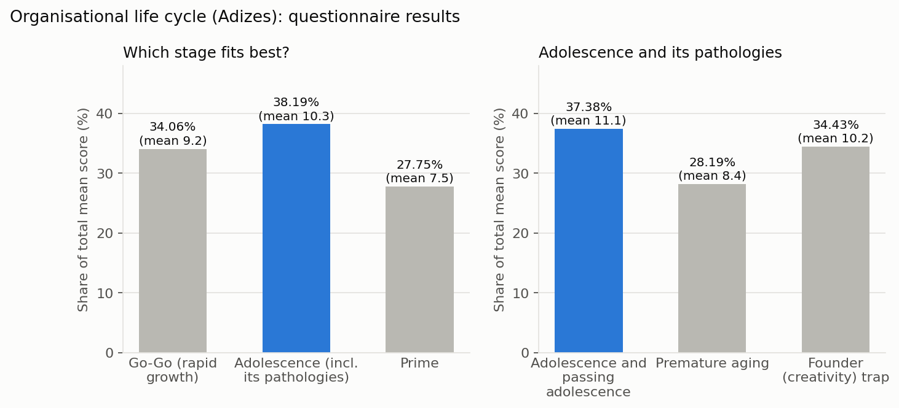
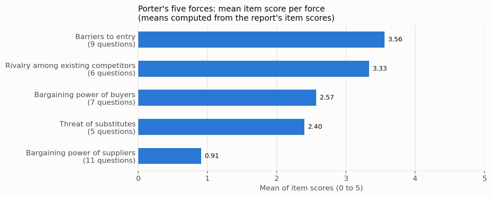
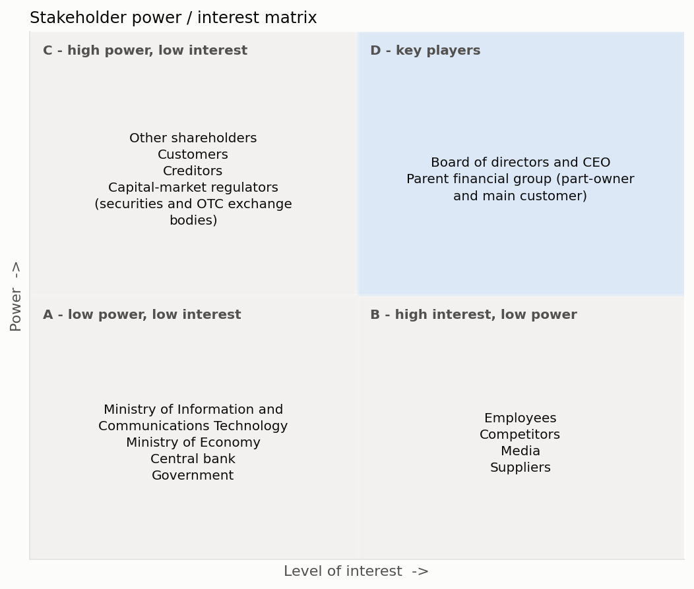
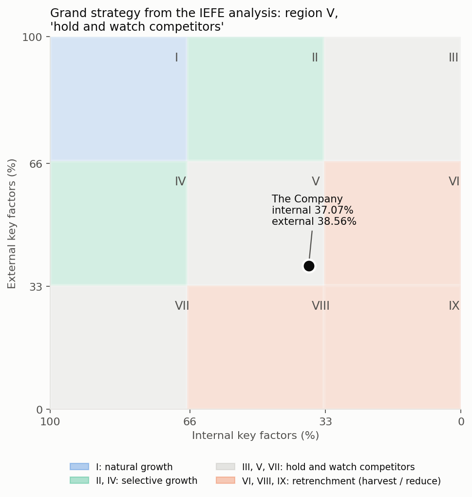
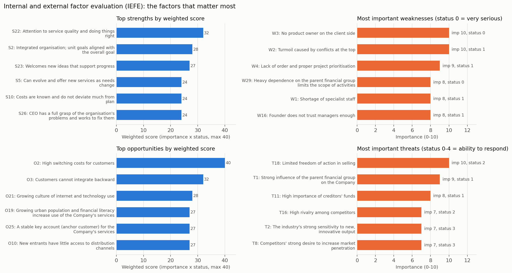

# Strategic Plan for an Iranian Capital-Market Fintech Company: Full Report (English, condensed)

The company's name and identifying details have been withheld for confidentiality.

This is a condensed English version of the original Persian course report (about 90 pages, autumn 2024). The original is not published because it identifies the company. Names of the company, its products, owners, partners and people have been replaced with generic descriptions ("the Company", "the parent financial group"). Long textbook passages on each framework have been shortened to one or two sentences. All scores and tables are reproduced as they appear in the report. Where a number was computed for this English version (for example, a mean of the report's item scores), this is stated.

Course: Strategic Planning and Management, Department of Industrial Engineering, Amirkabir University of Technology (Tehran Polytechnic). Instructor: Dr. Sirous. Team project. The team worked with the Company's management as business analysts / consultants.

## Contents

0. [Current situation](#0-current-situation)
1. [Degree of freedom: open vs. closed system](#1-degree-of-freedom-open-vs-closed-system)
2. [Organisational life cycle (Adizes)](#2-organisational-life-cycle-adizes)
3. [Porter's five forces](#3-porters-five-forces)
4. [PESTEL analysis](#4-pestel-analysis)
5. [Critical success factors (CSF)](#5-critical-success-factors-csf)
6. [Stakeholder analysis](#6-stakeholder-analysis)
7. [Vision, mission and values](#7-vision-mission-and-values)
8. [Grand strategy (IEFE / internal-external matrix)](#8-grand-strategy-iefe--internal-external-matrix)
9. [Objectives and strategies (SWOT / TOWS)](#9-objectives-and-strategies-swot--tows)

The work was delivered as a series of numbered reports (0 to 9). Each report states its goal, applies one framework, and ends with conclusions that feed the later reports. Reports 1 to 6 build the lists of strengths, weaknesses, opportunities and threats. Report 8 scores them. Report 9 turns them into strategies.

---

## 0. Current situation

**Goal:** understand the organisation as it is today.

**Profile**

| Item | Description |
|---|---|
| Industry | Financial technology (fintech): software for the capital market and financial services, plus payment services |
| Founded | Late 2010s, first registered for business acceleration, business planning and research services. Payment-facilitation services were added to its registered activities about two years later. |
| Mission (as described by the Company) | Design and develop new financial tools and support fintech start-ups |
| Main activity | Developing financial and capital-market software in partnership with established firms in the field |
| Products | Crowdfunding software, asset-management and smart-investment tools, capital-market management dashboards, payment and service-gateway software, and financial-market websites |
| Customers | Businesses in the IT and capital-market industries. The largest customer is a large financial-services group that is also a shareholder (the "parent financial group" below). |
| Staff | Fewer than 20 experienced staff, mainly programmers and designers |
| Ownership | One individual and three companies. The parent financial group held a large minority stake at founding. |
| Governance | A three-member board. One of the two founders is also a board member of the parent financial group. |
| Structure | The Company sits inside the parent group's network of financial-services companies (brokerage, advisory, asset management, investment funds and others). |

The report describes the Company as focused on innovative IT solutions that make capital-market businesses more efficient. Its stated aspiration is a digital world in which financial decisions are managed intelligently through capital-market software.

---

## 1. Degree of freedom: open vs. closed system

**Goal:** measure how "open" the organisation is and find its strengths and weaknesses.

**Framework.** The report uses the open-systems view of organisations. It compares open and closed systems on 24 characteristics, for example vision, control, conflict, evaluation, income, process, wholeness, sense of belonging, planning, boundaries, decision-making, delegation, self-knowledge, change and specialisation. An open system has a long-term vision, manages conflict, evaluates people on growth and learning, treats units as profit centres, and adapts to its environment. A closed system is short-term, avoids conflict, uses purely quantitative evaluation, and reacts only after problems happen.

**Method.** A 24-item questionnaire was completed by 5 staff: the CEO, the product manager, a UI designer, a front-end developer and a back-end developer. The CEO's and product manager's answers were weighted double. A characteristic with a weighted average below 140 was treated as a weakness. A characteristic above 170 was treated as a strength.

**Degree of freedom by respondent**

| Respondent | Degree of freedom |
|---|---:|
| CEO | 82.09 |
| Product manager | 80.26 |
| UI designer | 61.55 |
| Front-end developer | 68.34 |
| Back-end developer | 74.85 |
| **Weighted average (CEO and product manager x2)** | **75.63** |

**Score per characteristic (weighted average, as reported)**

| # | Characteristic | Score | Class | # | Characteristic | Score | Class |
|---:|---|---:|---|---:|---|---:|---|
| 1 | Vision | 148.4 | | 13 | Forces (synergy) | 112.6 | Weakness |
| 2 | Control | 94.4 | Weakness | 14 | Division of labour | 141.4 | |
| 3 | Conflict | 181.6 | Strength | 15 | Correction of deviation | 166.4 | |
| 4 | Evaluation | 129.0 | Weakness | 16 | Command | 167.2 | |
| 5 | Income | 38.4 | Weakness | 17 | Equilibrium | 107.2 | Weakness |
| 6 | Process-event | 109.2 | Weakness | 18 | Delegation | 146.8 | |
| 7 | Wholeness and integration | 169.3 | Strength | 19 | Self-knowledge | 104.2 | Weakness |
| 8 | Sense of belonging | 49.4 | Weakness | 20 | Change | 166.4 | |
| 9 | Activity and planning | 130.8 | Weakness | 21 | Specialisation | 195.8 | Strength |
| 10 | Boundaries | 170.4 | Strength | 22 | Mobility (proactivity) | 155.6 | |
| 11 | Event-start (equifinality) | 159.0 | | 23 | Methodology | 151.2 | |
| 12 | Decision-making and effect | 96.4 | Weakness | 24 | Interaction | 143.0 | |

Full respondent-level data: [`data/degree_of_freedom_items.csv`](../data/degree_of_freedom_items.csv).

**Weaknesses and suggested actions**

| Characteristic | Finding | Suggested action |
|---|---|---|
| Control | When disorder appears, attempts to control it create more disorder. Products and client projects change so often that staff have no time to adjust. | Have the main client appoint a product owner, and create proper communication between organisational levels. |
| Evaluation | Staff still feel evaluation is purely quantitative, despite management efforts. | More attention to technical-knowledge development. Collective-learning sessions: each person studies a new topic in their field and presents it to colleagues on the last working day. |
| Income | Part of the Company is owned by the parent financial group, which limits whom it can sell to. | Sell products that are not built only for one financial group; build more outside links; become more independent of current partner groups. |
| Process-event | Frequent product and order changes prevent stable, predictable processes. | More order and control, better communication between levels and better understanding of change, to standardise processes. |
| Sense of belonging | Low sense of belonging among programmers. | Give programmers a share in project profits or company equity after a set period; offer benefits they value (remote work one or two days a week, gifts, loans, a comfortable workplace). |
| Activity and planning | Many changes in short periods, with no product owner, make work reactive. | A product owner would make activities more predictable. |
| Decision-making and effect | Dependence on the parent financial group reduces independence. The Company is trying to become fully independent. | Complete the separation while keeping the cooperation; attract more partners and set independent goals. |
| Forces (synergy) | Linked to the low sense of belonging. | More welfare and group activities; standardised processes to free time for mutual learning. |
| Equilibrium | Dependence limits a balanced relationship with the outside world. | Independence from the parent group; no limit on the number of partnerships. |
| Self-knowledge | Weak communication between levels and with the client hides strengths and weaknesses. | An experienced product owner to collect client feedback and pass it to the team. |

**Strengths:** constructive handling of conflict (3); a strongly holistic, project-goal-focused organisation (7); flexible boundaries and a drive to expand them (10); identifying new job needs and hiring up-to-date skills (21).

**Conclusion.** The main weaknesses would fall sharply if the Company became independent. Even while dependent, it should widen its circle of partners to raise revenue, and improve benefits and working conditions to retain current experts and attract new ones, especially an experienced product owner. Its main strength is its will to improve and grow.

---

## 2. Organisational life cycle (Adizes)

**Goal:** locate the Company in the organisational life cycle and identify strengths and weaknesses.

**Framework.** The report reviews Adizes' ten-stage life-cycle model (Courtship, Infancy, Go-Go, Adolescence, Prime, Stability, Aristocracy, Early Bureaucracy, Bureaucracy, Death). A stage reflects behaviour, not age. Young organisations are flexible but hard to control; ageing ones are controllable but inflexible.

### 2.1 Qualitative analysis (interviews with the CEO and the product manager)

- **Turning point.** The Company started with two founders. One founder is a board member of the parent financial group. At the start the group held a large stake and the Company worked in one of the group's buildings. A few years later, once profitable, the Company moved to its own office to become more independent. This was a turning point.
- **Current state.** On one founder's proposal, and with both founders' approval, a capable CEO was appointed. The CEO is building new partnerships, pushing for independence (including buying back the group's shares), and focusing on product quality and effective internal systems.
- **Problems.** The push for independence created conflict between the founder linked to the group, the other founder and the CEO. Trust and respect among decision-makers have been damaged, which blocks stability. Job descriptions exist and authority has been delegated, but they do not say how work should be done. Where specialists are missing, the CEO takes on their duties; for example, the product-owner role is vacant and the CEO currently covers it.
- **Conclusion.** The Company shows the traits of **Adolescence**: an appointed CEO but strong founder dependence; a shift of focus to quality; new systems forming; unstable delegation; conflict between decision-makers (founder trap); founders in conflict with each other and with the CEO (risk of premature aging).

### 2.2 Quantitative analysis

Eight questionnaires were used: two for the Go-Go stage, four for Adolescence and its pathologies (in-stage, passing the stage, premature aging, founder/creativity trap), and two for Prime. The same five staff answered; the CEO was weighted double. Question-level results: [`data/life_cycle_questionnaires.csv`](../data/life_cycle_questionnaires.csv).

| Stage | Mean score | Share |
|---|---:|---:|
| Go-Go (rapid growth) | 9.2 | 34.06% |
| **Adolescence** | **10.3** | **38.19%** |
| Prime | 7.5 | 27.75% |

| Within Adolescence | Mean score | Share |
|---|---:|---:|
| **Adolescence and passing Adolescence** | **11.1** | **37.38%** |
| Premature aging | 8.4 | 28.19% |
| Founder (creativity) trap | 10.2 | 34.43% |

The stages score close to each other, but Adolescence is highest, which confirms the qualitative result. The report notes that five respondents give an indication, not an exact measure.

**Statements that scored above 12**

- Adolescence: visible conflict among senior managers; personal goals clash with organisational goals, with suspicion and rumours; the Company is trying to set up complaint handling and after-sales service; it is trying to raise profit through more careful work and quality; it is launching new products and quality standards; job descriptions exist but do not say how work is done; management has delegated some authority but still steps in directly; new ideas are welcome if they do not strain finances and resources.
- Founder trap: the founders have different orientations (risk-taking vs. conservative); the entrepreneurial founder has limited the board's authority; a professional manager was hired from outside but the entrepreneurial founder still controls the Company; there is a power struggle between the entrepreneurial founder and the board.
- Premature aging: conflicts have quickly reduced trust and respect among decision-makers.

**Strengths identified (23):** can develop new services as needs change; covers a large share of customer needs with diverse services; open to change; does not judge success by sales alone; can produce action plans; costs are known and close to plan; workable schedules; plans for growth without missing opportunities; clear responsibilities; people-focused but stable; staff can do varied work; everyone does what is needed; management focused on the organisation; management knows its duties; acceptable pay system; acceptable sense of belonging; experienced staff; values experienced staff; improving internal systems; attention to quality; welcomes new ideas; management defining templates; not afraid of failure.

**Weaknesses identified (29):** lack of space; management tries to seize every opportunity; capital-allocation crisis; hard to control budget-vs-cost variance; job descriptions do not say how to work; some liquidity problems; strong conflict among senior managers; too many and too long meetings; individual vs. organisational goals; no effective systems yet; systems and policies not fully followed; gap between forecasts and results; no effective reward system; lack of trust and respect among decision-makers; founder does not trust managers; managers lack authority; managers lack power to run the Company; visible board-founder conflict; no expert groups for decisions; failure is normal; no proper reward and penalty system; no training system; no budget for management training; no established market share; poor quality-quantity balance; scattered focus; not enough attention to market needs and marketing; each founder pursues own interests.

---

## 3. Porter's five forces

**Goal:** find threats and opportunities in the Company's immediate industry environment.

The strategy team scored each force through a set of questions. Scores range from 0 to 5 in the report.

**Force 1. Rivalry among existing competitors**

| # | Question | Score |
|---:|---|---:|
| 1 | Level of fixed costs in the industry | 2 |
| 2 | Market growth rate in the industry | 5 |
| 3 | Current intensity of rivalry | 4 |
| 4 | Product diversity among competitors | 3 |
| 5 | Relative increase in competitors' capacity | 4 |
| 6 | Freedom of action in selling | 2 |

**Force 2. Bargaining power of buyers**

| # | Question | Score |
|---:|---|---:|
| 1 | Number and volume of potential and actual customers | 2 |
| 2 | Customer's cost of buying from another producer (switching cost) | 4 |
| 3 | Availability of substitutes that could draw customers away | 2 |
| 4 | How standard and undifferentiated our products are | 1 |
| 5 | Company's financial dependence on customer purchases | 5 |
| 6 | Buyers' information on quality, price and features | 4 |
| 7 | Customers' ability to integrate backward | 0 |

**Force 3. Bargaining power of suppliers**

| # | Question | Score |
|---:|---|---:|
| 1 | Number of key suppliers and creditors | 0 |
| 2 | Substitutability of suppliers' inputs | 5 |
| 3 | Supplier ability to change technology so other suppliers no longer fit | 0 |
| 4 | Likelihood that suppliers become serious competitors | 0 |
| 5 | Suppliers' role in the quality of output | 1 |
| 6 | Degree of supplier monopoly | 0 |
| 7 | Cost of switching suppliers | 0 |
| 8 | Importance of the Company to suppliers | 0 |
| 9 | How essential suppliers' products are for survival | 0 |
| 10 | How essential creditors' funds are for survival | 4 |
| 11 | Suppliers' ability to block forward integration | 0 |

**Force 4. Barriers to entry**

| # | Question | Score |
|---:|---|---:|
| 1 | Economies of scale as a barrier | 3 |
| 2 | Differentiation as a barrier | 5 |
| 3 | Importance of brand name | 4 |
| 4 | Cost to current customers of switching to a new entrant | 5 |
| 5 | New entrants' access to distribution channels | 1 |
| 6 | New entrants' access to technology and know-how | 2 |
| 7 | New entrants' access to essential inputs | 4 |
| 8 | Initial capital needed to enter at economic scale | 3 |
| 9 | Government's ability to block entry through restrictive rules | 5 |

**Force 5. Threat of substitutes**

| # | Question | Score |
|---:|---|---:|
| 1 | Risk of substitutes entering | 1 |
| 2 | Customer's cost of switching to a substitute | 5 |
| 3 | Substitutes' profitability and market-penetration potential | 1 |
| 4 | Trend of falling prices and improving quality of substitutes | 1 |
| 5 | Competitors' desire to increase penetration or capacity | 4 |

Mean item score per force (computed for this English version from the tables above): barriers to entry 3.56; rivalry 3.33; buyer power 2.57; substitutes 2.40; supplier power 0.91.

**Conclusion (from the report).** Supplier power is clearly very low. Rivalry and barriers to entry scored high. Buyer power and substitutes sit near the middle. Suppliers pose no special threat. High rivalry is a major threat that could erode potential profit. High entry barriers protect the Company from new competitors, which is an opportunity. The Company must still watch for substitution and loss of customers to competitors.

| Force | Opportunities | Threats |
|---|---|---|
| Rivalry | Market growth rate | Diversity of competitors' products; intensity of rivalry; relative increase in competitors' capacity; limited freedom of action in selling |
| Buyers | High switching cost for customers; low substitutability of the product; customers cannot integrate backward | Small number of customers; financial dependence on buyers; customers are well informed about the product |
| Suppliers | Few key suppliers; inputs easy to substitute; suppliers have little effect on quality; low cost of switching suppliers; no forward-integration threat | High importance of creditors' funds |
| Barriers to entry | Differentiation matters; high switching cost for customers; new entrants have little access to distribution channels and know-how | High importance of brand name; strong effect of restrictive government rules |
| Substitutes | Low risk of substitutes; high cost for customers to use a substitute | Competitors' strong desire to increase market penetration |

---

## 4. PESTEL analysis

**Goal:** assess the macro-environment and its threats and opportunities.

The report explains PESTEL (political, economic, social, technological, environmental, legal) and its variants, then follows four steps: think, research, analyse (a team brainstorming session) and decide. Each factor was given a status and an impact score. The report does not define the impact scale; values range from -4 to +5, and one factor has no score. Full table: [`data/pestel.csv`](../data/pestel.csv).

**Political**

| Factor | Status | Impact |
|---|---|---:|
| *Foreign policy* | | |
| Country's international relations and standing | Poor but improving | 1 |
| Relations with Muslim and regional countries | Unfavourable | 1 |
| Level of international and regional disputes | Poor | 1 |
| Ability to cope with sanctions | Improving | 1 |
| Foreign-policy crises | Poor | -2 |
| Relations with border communities of neighbouring countries | Good | 0 |
| Country's defence capability in the political arena | Unfavourable | 0 |
| Terrorism in the region | Poor | 0 |
| War and unrest in the region | Poor | 0 |
| Regional and bilateral trade agreements | Improving | 2 |
| Process of joining the WTO | Improving | 2 |
| *Domestic policy* | | |
| Deregulation trend | Improving | 4 |
| De-monopolisation and privatisation trend | Improving | 4 |
| Expansion of democracy and individual freedoms | Poor but improving | 3 |
| Government transparency | Poor | 1 |
| Changes in government and state bodies | Unfavourable | 1 |
| Public commitment to elections | Unfavourable | 0 |
| Orientation of media and political parties | Unfavourable | 1 |
| Conflicts between parties and groups | Unfavourable | 0 |

**Economic**

| Factor | Status | Impact |
|---|---|---:|
| GNP and GDP | Unfavourable | 3 |
| Per-capita income and economic growth | Low | 4 |
| Inflation and budget deficit | Poor | -1 |
| Savings, assets and debts | Unfavourable | 2 |
| Foreign-exchange use, earnings and savings | Unfavourable | 3 |
| Domestic and foreign investment | Improving | 3 |
| Government spending and budget | Rising | -1 |
| Exchange and interest rates | Unfavourable | 1 |
| Export and import potential | Poor | 0 |
| Taxes | Rising | 0 |
| Communications infrastructure | Improving | 3 |
| Sea, air and land transport infrastructure | Unfavourable | 0 |
| Worn-out infrastructure | Unfavourable | -2 |
| Risk and crisis management | Poor | -1 |
| Banking system | Improving | 4 |
| Cost of access to capital and the stock-market mechanism | Favourable | 5 |

**Socio-cultural**

| Factor | Status | Impact |
|---|---|---:|
| Urban and rural population and its distribution | Unfavourable | 1 |
| Growth of cultural and social crises | Poor | 0 |
| Customs and traditions | Good | 0 |
| Age distribution; poverty, homelessness and addiction | Unfavourable | -1 |
| Migration to cities | High and unfavourable | 2 |
| Employment and unemployment | Unfavourable | -1 |
| Welfare-organisation policies | Unfavourable | 0 |
| Consumption patterns and purchasing power | Poor and worsening | 3 |
| Attention to tourism | Improving | 0 |
| Hospitals and medical centres | Good | 0 |
| Vaccination and immunisation | Good | 0 |
| Quality of education and school development | Good | 0 |
| Cost of education | Good | 0 |
| Murder and theft rates | Good | 0 |
| Judiciary policies | Unfavourable | -1 |
| Access to consumer markets | Improving | 4 |
| Natural resources | Good | 0 |
| Geopolitical position | Unfavourable | -3 |

**Technological**

| Factor | Status | Impact |
|---|---|---:|
| Domestic technology level versus world average | Medium | 4 |
| Technology complexity at different levels | Improving | 4 |
| Automation of production processes | Poor but improving | 0 |
| Return on technology investment in the industry | Favourable | 3 |
| Value added of technology investment in the industry | Favourable | 3 |
| Export potential of specialised industry software | Improving | 4 |
| Technology transfer in the industry | Poor | (not scored) |
| Internet use in the industry | Unfavourable but improving | 5 |
| E-commerce use in the industry | Improving | 5 |
| E-marketing use in the industry | Improving | 5 |
| Effect of nano- and biotechnology on the industry | Improving | 0 |
| Effect of the country's nuclear-energy situation on the industry | Favourable | 0 |
| Management information systems and information security | Unfavourable but improving | 5 |
| Copyright and intellectual property | Poor | 5 |

**Legal**

| Factor | Status | Impact |
|---|---|---:|
| Articles of association and various by-laws | Mandatory and unfavourable | -4 |
| Rules and resolutions of the general assembly and owners | Good | 3 |
| Sectoral, cross-sectoral and provincial development documents | Good | 0 |
| National development-plan policies | Unfavourable | 5 |
| Cabinet rules and resolutions | Unfavourable | 2 |
| Rules of the national planning and budget organisation | Improving | 1 |
| Free-trade laws | Weak | 4 |
| Investment and financial laws | Improving | 5 |
| E-commerce and e-marketing laws | Favourable | 4 |
| Labour law | Favourable | -1 |
| Other laws and resolutions of legislative bodies | Unfavourable | -3 |

**Environmental.** Of 18 factors (air, water, land, energy, natural disasters), 13 have an impact of 0. Non-zero scores: urban and rural development +2; cost of electricity supply +1; energy management -1; energy consumption and prices -1; likelihood of floods and earthquakes -1.

**Conclusion (from the report).** Environmental factors have the least impact. Technological and legal factors have the most, which fits a finance-and-technology company.

| Category | Opportunities | Threats |
|---|---|---|
| Political | Deregulation (financial activity grows in freer conditions); de-monopolisation (entry into monopolised markets) | Political factors act mostly indirectly; a foreign-policy crisis could hurt access to foreign markets |
| Economic | More capital circulation, output, income and growth; better communications infrastructure; easy public access to the stock exchange and OTC market raises demand for financial software; sound banking supports both financing and customer use | Inflation lowers purchasing power and use of investment software; weak communications infrastructure; decline in national financial indicators |
| Socio-cultural | Urbanisation and rising financial and technology literacy; Iran's location gives access to varied foreign markets; higher welfare raises use of financial software | Unfavourable geopolitical position could cut sales and access to foreign markets |
| Technological | Rising technology complexity, value of technology investment and software-export potential; growing internet use; good information security builds trust in financial software; copyright law protects the Company's products | (none listed) |
| Legal | Effective investment, finance, e-commerce and e-marketing laws build public confidence; better free-trade laws; national development policies push technology use | Tension between regulation and freedom: fewer burdensome rules could expand activity, although less regulation has downsides for order and fairness |
| Environmental | Urban and rural development could raise use of the Company's services (small effect) | Severe natural disasters could affect servers and databases (very low likelihood) |

---

## 5. Critical success factors (CSF)

**Goal:** find strengths and weaknesses through internal analysis.

CSFs are treated as bottlenecks: the roughly 20% of factors that decide about 80% of success (Pareto). The team and Company staff identified three.

| CSF | Likely causes | Root cause | Quick fixes |
|---|---|---|---|
| 1. Shortage of specialist staff | National shortage of specialists; lower pay and benefits than foreign companies; the Company is less known than large Iranian holdings | Given Iran's economic situation, specialists prefer to work remotely for foreign companies | Raise pay and benefits for specialists; hire from a wider geographic area; advertise to build the Company's name; train fairly strong staff into specialists |
| 2. Disputes between founders | Conflicting interests; different ethics and views; disputes have become entrenched and founders do not fully cooperate to resolve them | Interests and frameworks were not defined properly at the start of the partnership | Use conflict management; use a third party trusted by all founders to move work forward for a period |
| 3. Poor prioritisation of projects | Unclear customer priorities; weak planning; weak coordination between the client and the Company | No product owner on the client side | Ask the client to name a product manager or product owner |

**Resulting points:** shortage of specialist staff; founder disputes; organisational turmoil caused by top-level disputes; no client-side product owner; no order or proper prioritisation of projects (weaknesses); the CEO's full grasp of the problems and effort to solve them (strength).

---

## 6. Stakeholder analysis

**Goal:** find threats and opportunities by analysing the Company's stakeholders. The report defines stakeholders as people and groups that depend on the organisation for part of their goals, and on which the organisation also depends. It uses four steps.

**Step 1. Sun diagram (relationships)**

| Stakeholder | Relationship with the Company |
|---|---|
| Parent financial group | Creates added value for both; intervenes in policy-making, monitoring and evaluation |
| Board of directors and CEO | Set rules, leadership, policy, monitoring and evaluation; legal authority |
| Shareholders | Provide financial resources and receive profit |
| Creditors | Provide needed financial resources |
| Customers | The Company meets their needs and earns revenue |
| Employees | Incentive system; aligning individual and organisational goals; staff benefit from the organisation |
| Suppliers | Provide needed resources and earn profit |
| Competitors | Affect the Company's market share and the progress of the industry |
| Media | Platform for advertising and marketing |
| Government | Laws that affect how the Company operates |
| Central bank | Resolutions that affect the Company and its access to credit |
| Ministry of ICT; Ministry of Economy | Rules that affect the Company's operating framework |
| Capital-market regulators (securities and OTC exchange bodies) | Rules and resolutions that affect the Company |

**Step 2. Stakeholder matrix (type of stake vs. type of power)**

| Stake \ Power | Political | Economic | Legislative (formal) |
|---|---|---|---|
| Ownership | Board; CEO; parent financial group | Shareholders; parent financial group | Board and CEO; parent financial group; shareholders |
| Economic dependence | Competitors; suppliers; customers | Competitors; suppliers; employees; customers; creditors; parent financial group | Central bank; creditors |
| Social | Media; government | Media | Ministry of Economy; Ministry of ICT; capital-market regulators |

**Step 3. Circle model (closeness of influence)**

- Inner circle: board and CEO; parent financial group.
- Middle circle: employees, customers, competitors, suppliers, creditors, other shareholders.
- Outer circle: government, central bank, media, capital-market regulators, Ministry of ICT, Ministry of Economy.

**Step 4. Power / interest matrix**

| | Low interest | High interest |
|---|---|---|
| **High power** | C: other shareholders; customers; creditors; capital-market regulators | D (key players): board and CEO; parent financial group |
| **Low power** | A: Ministry of ICT; Ministry of Economy; central bank; government | B: employees; competitors; media; suppliers |

**Threats**

- The parent financial group affects all of the Company's activities. It is the main customer and one of the owners. Its strong influence is a major threat.
- Sudden rule changes by the capital-market regulator that oversees new financial systems could, on their own, stop the Company's operations.
- Sudden changes in central-bank, ICT-ministry or economy-ministry rules.
- The industry is sensitive to new, innovative output, so new services from competitors threaten the Company's share of a non-fixed market.

**Opportunities**

- The parent financial group has many subsidiaries, all of which use the Company's services. The Company therefore always has a large key account.
- The same sensitivity to innovation is a strong opportunity if the Company itself launches new, different services.
- As competitors and the Company grow stronger, foreign markets could be won. Competition can catalyse growth for the whole group of firms.

---

## 7. Vision, mission and values

Drafted after discussion with the steering group and questionnaires.

**Values**

1. To be recognised as part of the country's payment infrastructure.
2. To improve the business ecosystem and the level of innovation in Iran's IT and capital-market industry.
3. To provide innovative, advanced IT solutions.

**Vision.** Capture **20% market share within 10 years** by shaping an innovative future for financial technology in Iran's capital market.

**Mission.** The Company seeks a dynamic digital world managed intelligently through capital-market software. It believes that wider access to information and advanced technology increasingly strengthens the financial abilities of people and companies and helps investment and innovative businesses. It therefore aims to add new, cutting-edge features to every product, as a step toward wider fintech use in Iran's capital market. In five-year periods it plans to offer new features and products to current products and customers and to retain them. Some planned features have not yet been implemented in Iran. **Years 1-5:** new features for the main product, crowdfunding, and groundwork for the next innovative products. **Years 6-10:** focus on new products that do not exist yet but that current customers need.

---

## 8. Grand strategy (IEFE / internal-external matrix)

**Goal:** set the grand strategy that gives direction to all other strategies.

**Method (internal-external factor evaluation, IEFE).**

1. Each strength, weakness, opportunity and threat gets an importance score from 0 to 10 (within its own group).
2. Each gets a status score. For opportunities and threats: 0 = cannot use the opportunity or respond to the threat, up to 4 = can do so well. For weaknesses: 0 = very serious, 1 = serious, 2 = fairly serious. For strengths: 2 = fairly strong, 3 = strong, 4 = very strong.
3. Weighted score = importance x status (maximum 40 per factor).
4. Internal % = 100 x (sum of S and W weighted scores) / (40 x number of internal factors). External % is calculated the same way with O and T.
5. The two percentages place the Company in a 3 x 3 matrix (cut-offs at 33% and 66%):
   - Region I: natural growth.
   - Regions II and IV: selective growth (choose only the most attractive growth options).
   - Regions III, V and VII: hold and watch competitors (maintain market share and position).
   - Regions VI, VIII and IX: retrenchment (harvest, gradually exit or change scope).

**Results**

| Factors | Sum of weighted scores | Number of factors | Percentage |
|---|---:|---:|---:|
| Internal (26 strengths + 32 weaknesses) | 860 (570 + 290) | 58 | **37.07%** |
| External (27 opportunities + 18 threats) | 694 (463 + 231) | 45 | **38.56%** |

Both percentages fall between 33% and 66%, so the Company is in **region V**. The grand strategy is **"hold and watch competitors"**.

### 8.1 Strengths

| # | Strength | Importance | Status | Weighted |
|---:|---|---:|---:|---:|
| 1 | Handles conflict well to advance goals | 5 | 3 | 15 |
| 2 | Integrated organisation; unit goals aligned with the overall goal | 7 | 4 | 28 |
| 3 | Drive to expand the organisation's boundaries | 9 | 2 | 18 |
| 4 | Ability to identify and attract needed expertise | 8 | 2 | 16 |
| 5 | Can evolve and offer new services as needs change | 8 | 3 | 24 |
| 6 | Can cover a large share of customer needs through diverse services | 8 | 3 | 24 |
| 7 | Open to change; constantly works to progress | 8 | 3 | 24 |
| 8 | Does not judge success by sales alone | 7 | 3 | 21 |
| 9 | Can produce suitable action plans for its goals | 7 | 3 | 21 |
| 10 | Costs are known and do not deviate much from plan | 6 | 4 | 24 |
| 11 | Workable schedules and enough focus on organisational tasks | 7 | 3 | 21 |
| 12 | Plans for growth but does not miss opportunities | 8 | 3 | 24 |
| 13 | Clear responsibilities; orderly work | 7 | 3 | 21 |
| 14 | Cares about people but does not let individual changes disrupt work | 7 | 3 | 21 |
| 15 | Staff are allowed to do a variety of activities | 7 | 3 | 21 |
| 16 | Everyone is expected to do what is needed | 7 | 3 | 21 |
| 17 | Management is focused on the organisation itself | 7 | 3 | 21 |
| 18 | Management knows its duties and tries to do them properly | 7 | 3 | 21 |
| 19 | Experienced and capable staff | 7 | 2 | 14 |
| 20 | Values its experienced and capable staff | 7 | 3 | 21 |
| 21 | Working to improve organisational systems | 7 | 3 | 21 |
| 22 | Attention to service quality and doing things right | 8 | 4 | 32 |
| 23 | Welcomes new ideas that support progress | 9 | 3 | 27 |
| 24 | Management is trying to define standard templates | 7 | 3 | 21 |
| 25 | Not afraid of failure | 8 | 3 | 24 |
| 26 | CEO has a full grasp of the problems and works to fix them | 8 | 3 | 24 |
| | **Total** | | | **570** |

### 8.2 Weaknesses

| # | Weakness | Importance | Status | Weighted |
|---:|---|---:|---:|---:|
| 1 | Shortage of specialist staff | 8 | 1 | 8 |
| 2 | Turmoil caused by conflicts at the top | 10 | 1 | 10 |
| 3 | No product owner on the client side | 10 | 0 | 0 |
| 4 | Lack of order and proper project prioritisation | 9 | 1 | 9 |
| 5 | Lack of office space | 7 | 2 | 14 |
| 6 | Management tries to exploit every available opportunity | 7 | 2 | 14 |
| 7 | Capital-allocation crisis when pursuing opportunities | 6 | 2 | 12 |
| 8 | Hard to control budget-versus-cost variance | 6 | 2 | 12 |
| 9 | Job descriptions do not say how tasks should be done | 6 | 1 | 6 |
| 10 | Number and length of meetings has grown | 6 | 2 | 12 |
| 11 | Individual goals conflict with organisational goals | 6 | 1 | 6 |
| 12 | Still lacks effective systems and templates | 6 | 1 | 6 |
| 13 | Systems, policies and templates are not fully followed | 5 | 2 | 10 |
| 14 | Gap between forecasts and actual performance | 6 | 2 | 12 |
| 15 | No effective reward and pay system | 6 | 2 | 12 |
| 16 | Founder does not trust managers enough | 8 | 1 | 8 |
| 17 | Managers lack sufficient authority | 8 | 1 | 8 |
| 18 | Visible conflict between the board and the founder | 8 | 1 | 8 |
| 19 | No expert groups for decision-making | 7 | 1 | 7 |
| 20 | Failure is treated as normal | 5 | 2 | 10 |
| 21 | No training system for staff | 7 | 1 | 7 |
| 22 | Insufficient budget for management training | 5 | 2 | 10 |
| 23 | No established market share | 8 | 2 | 16 |
| 24 | Poor balance between quality and quantity | 5 | 2 | 10 |
| 25 | Focus is spread across many areas | 5 | 2 | 10 |
| 26 | Insufficient attention to market needs and marketing | 5 | 2 | 10 |
| 27 | Frequent changes leave too little time to bring order | 5 | 2 | 10 |
| 28 | Staff evaluation is machine-oriented (purely quantitative) | 5 | 2 | 10 |
| 29 | Heavy dependence on the parent financial group limits the scope of activities | 8 | 0 | 0 |
| 30 | Changing products prevent stable processes | 5 | 2 | 10 |
| 31 | Programmers lack a sense of belonging | 5 | 1 | 5 |
| 32 | Some processes cannot be forecast because of frequent change | 4 | 2 | 8 |
| | **Total** | | | **290** |

### 8.3 Opportunities

| # | Opportunity | Importance | Status | Weighted |
|---:|---|---:|---:|---:|
| 1 | Rivalry among competitors can grow the market and the industry | 6 | 2 | 12 |
| 2 | High switching costs for customers | 10 | 4 | 40 |
| 3 | Customers cannot integrate backward | 8 | 4 | 32 |
| 4 | Few key suppliers | 2 | 4 | 8 |
| 5 | Inputs are easy to substitute | 2 | 4 | 8 |
| 6 | Suppliers have little effect on product quality | 4 | 4 | 16 |
| 7 | Low cost for the Company to switch suppliers | 6 | 4 | 24 |
| 8 | Hard for suppliers to integrate forward | 4 | 4 | 16 |
| 9 | Product differentiation matters a lot | 4 | 4 | 16 |
| 10 | New entrants have little access to distribution channels | 9 | 3 | 27 |
| 11 | New entrants have little access to the required know-how | 4 | 4 | 16 |
| 12 | Substitute products are not a major risk | 4 | 4 | 16 |
| 13 | The Company could work better under deregulation | 9 | 1 | 9 |
| 14 | De-monopolisation could widen the Company's scope | 9 | 2 | 18 |
| 15 | Growth in any economic indicator helps the Company | 4 | 2 | 8 |
| 16 | Better communications infrastructure supports growth | 7 | 1 | 7 |
| 17 | Easy public access to the stock exchange and OTC market | 5 | 4 | 20 |
| 18 | Sound banking systems ease work for the Company and customers | 7 | 3 | 21 |
| 19 | Growing urban population and financial literacy | 9 | 3 | 27 |
| 20 | Iran's location gives access to diverse markets | 5 | 1 | 5 |
| 21 | Growing culture of internet and technology use | 7 | 4 | 28 |
| 22 | Adequate level of cybersecurity in the country | 4 | 4 | 16 |
| 23 | Copyright and intellectual-property laws | 1 | 4 | 4 |
| 24 | Need for technology in national development | 7 | 2 | 14 |
| 25 | A stable key account for the Company's services | 9 | 3 | 27 |
| 26 | The industry's sensitivity to new, innovative output | 8 | 3 | 24 |
| 27 | Ability to enter foreign markets through constructive competition | 4 | 1 | 4 |
| | **Total** | | | **463** |

### 8.4 Threats

| # | Threat | Importance | Status | Weighted |
|---:|---|---:|---:|---:|
| 1 | Strong influence of the parent financial group on the Company | 9 | 1 | 9 |
| 2 | The industry's strong sensitivity to new, innovative output | 7 | 3 | 21 |
| 3 | Sudden rule changes by influential agencies and ministries | 1 | 3 | 3 |
| 4 | Iran's unfavourable geopolitical position | 6 | 1 | 6 |
| 5 | High inflation and falling purchasing power | 6 | 2 | 12 |
| 6 | Weak infrastructure in the country | 3 | 2 | 6 |
| 7 | Decline in the country's financial indicators and capacity | 5 | 1 | 5 |
| 8 | Competitors' strong desire to increase market penetration | 7 | 3 | 21 |
| 9 | High importance of brand name | 6 | 3 | 18 |
| 10 | Strong effect of restrictive government rules | 6 | 2 | 12 |
| 11 | High importance of creditors' funds | 8 | 1 | 8 |
| 12 | Small number of customers | 6 | 3 | 18 |
| 13 | Financial dependence on customers | 4 | 3 | 12 |
| 14 | Customers are well informed about the product | 6 | 4 | 24 |
| 15 | Wide variety of products on the market | 5 | 2 | 10 |
| 16 | High rivalry among competitors | 7 | 2 | 14 |
| 17 | Relative increase in competitors' capacity | 4 | 3 | 12 |
| 18 | Limited freedom of action in selling | 10 | 2 | 20 |
| | **Total** | | | **231** |

---

## 9. Objectives and strategies (SWOT / TOWS)

**Goal:** set the Company's strategies and objectives.

**Method.** The report uses a nine-cell SWOT (TOWS) matrix. Internal factors (S, W) meet external factors (O, T) in four strategy cells: SO (aggressive: use strengths to seize opportunities), WO (improvement: fix weaknesses to seize opportunities), ST (defensive: use strengths against threats) and WT (defensive-contraction: reduce weaknesses to avoid threats). Steps: identify internal factors; identify external factors; build the matrix; pair factors and write strategies; prioritise.

### 9.1 Reduced SWOT

A full SWOT matrix was first built from all 103 factors. Because not all factors are prominent enough to shape strategy, the team kept a reduced set (numbering below is for this section only):

| Strengths (S) | Weaknesses (W) |
|---|---|
| S1 Drive to expand the organisation's boundaries | W1 Shortage of specialist staff |
| S2 Can evolve and offer new services as needs change | W2 Turmoil caused by conflicts at the top |
| S3 Open to change; constantly works to progress | W3 No product owner on the client side |
| S4 Plans for growth but does not miss opportunities | W4 Lack of order and proper project prioritisation |
| S5 Management is focused on the organisation itself | W5 Founder does not trust managers enough |
| S6 Working to improve organisational systems | W6 Managers lack sufficient authority |
| S7 Attention to service quality and doing things right | W7 Visible conflict between the board and the founder |
| S8 Welcomes new ideas that support progress | W8 Programmers lack a sense of belonging |
| S9 Management is trying to define standard templates | W9 Heavy dependence on the parent financial group |
| S10 CEO has a full grasp of the problems and works to fix them | |

| Opportunities (O) | Threats (T) |
|---|---|
| O1 Rivalry can grow the market and the industry | T1 Strong influence of the parent financial group |
| O2 High switching costs for customers | T2 The industry's strong sensitivity to innovative output |
| O3 Product differentiation matters a lot | T3 Competitors' strong desire to increase market penetration |
| O4 New entrants have little access to distribution channels | T4 Strong effect of restrictive government rules |
| O5 The Company could work better under deregulation | T5 Customers are well informed about the product |
| O6 Growing urban population and financial literacy | T6 High rivalry among competitors |
| O7 Growing culture of internet and technology use | T7 Limited freedom of action in selling |
| O8 A stable key account for the Company's services | |
| O9 The industry's sensitivity to innovative output | |

### 9.2 Pairwise analysis

Each internal factor was checked against each external factor. Where a sensible strategy existed, it was written in the cell. The matrices below show which pairs produced a strategy (Y) and which did not (-).

**SO (56 strategies)**

| | O1 | O2 | O3 | O4 | O5 | O6 | O7 | O8 | O9 |
|---|---|---|---|---|---|---|---|---|---|
| S1 | Y | - | Y | - | Y | Y | Y | - | Y |
| S2 | Y | - | Y | - | Y | Y | Y | Y | Y |
| S3 | Y | - | Y | - | Y | - | Y | - | Y |
| S4 | Y | - | Y | - | Y | Y | Y | Y | Y |
| S5 | - | Y | Y | - | Y | Y | Y | Y | Y |
| S6 | Y | Y | Y | Y | Y | Y | Y | Y | Y |
| S7 | Y | Y | - | - | - | Y | Y | Y | - |
| S8 | Y | - | Y | - | Y | - | - | - | Y |
| S9 | Y | - | - | - | Y | - | - | Y | - |
| S10 | - | Y | - | - | Y | - | - | Y | - |

Examples: expand the Company's boundaries through a market that grows with rivalry, through differentiated products, through deregulation, through more financially literate customers, through building a culture of technology use, and by focusing on innovative output (S1); retain the stable key account by offering new services (S2 x O8); use the high switching cost for customers through quality and systems improvement (S6, S7 x O2).

**ST (53 strategies)**

| | T1 | T2 | T3 | T4 | T5 | T6 | T7 |
|---|---|---|---|---|---|---|---|
| S1 | Y | Y | Y | - | Y | Y | Y |
| S2 | - | Y | Y | - | Y | Y | - |
| S3 | Y | Y | Y | - | Y | Y | Y |
| S4 | Y | Y | Y | - | Y | Y | Y |
| S5 | Y | Y | Y | - | Y | Y | Y |
| S6 | Y | Y | Y | - | Y | Y | Y |
| S7 | - | Y | Y | - | Y | Y | - |
| S8 | Y | Y | Y | - | Y | Y | Y |
| S9 | - | Y | Y | - | Y | Y | - |
| S10 | Y | - | Y | - | Y | Y | Y |

Every strength was used to weaken the threats of competitor expansion (T3), well-informed customers (T5) and high rivalry (T6). No strategy was found against restrictive government rules (T4). Example: weaken the parent group's strong influence by expanding the Company's boundaries (S1 x T1).

**WO (23 strategies)**

| | O1 | O2 | O3 | O4 | O5 | O6 | O7 | O8 | O9 |
|---|---|---|---|---|---|---|---|---|---|
| W1 | Y | - | - | Y | - | Y | - | - | - |
| W2 | - | Y | - | - | - | - | - | Y | - |
| W3 | - | Y | - | - | - | - | - | Y | - |
| W4 | - | Y | Y | Y | - | - | - | Y | Y |
| W5 | - | Y | - | - | - | - | - | Y | - |
| W6 | - | Y | - | - | - | - | - | Y | - |
| W7 | - | Y | - | - | - | - | - | Y | - |
| W8 | Y | - | Y | - | - | - | - | - | Y |
| W9 | - | Y | - | - | - | - | - | Y | - |

Most WO strategies use the two "cushions" the Company has: high customer switching costs (O2) and the stable key account (O8). They limit the damage from internal conflict, the missing product owner, weak trust and dependence while those weaknesses are fixed. Other examples: build programmers' sense of belonging through a motivating environment for differentiated and innovative products (W8 x O3, O9); offset the specialist shortage using the growing labour pool (W1 x O6).

**WT (20 strategies)**

| | T1 | T2 | T3 | T4 | T5 | T6 | T7 |
|---|---|---|---|---|---|---|---|
| W1 | - | - | Y | - | Y | Y | - |
| W2 | Y | - | - | - | - | Y | - |
| W3 | - | - | - | - | - | Y | - |
| W4 | - | Y | - | - | - | Y | - |
| W5 | Y | Y | - | - | - | Y | - |
| W6 | Y | Y | - | - | - | Y | - |
| W7 | Y | Y | - | - | - | Y | - |
| W8 | - | - | - | - | - | Y | - |
| W9 | Y | Y | - | - | - | - | - |

Examples: turn the innovation threat into an opportunity through proper project prioritisation and a dedicated innovation budget (W4 x T2); widen managers' authority by reducing the parent group's power over the Company (W5, W6 x T1); focus on goals shared by the parent group and management to reduce disputes (W7 x T1); build programmers' sense of belonging and keep specialists out of competitors' reach (W8 x T6); reduce dependence on the parent group and shift focus to innovative output (W9 x T2).

In total the pairwise analysis produced 152 candidate strategies.

### 9.3 Final strategies

Strategies that did not fit the grand strategy ("hold and watch competitors") were removed. The best of the rest were selected:

1. **Retain the large, stable key accounts by offering new services.**
2. **Hire a product owner and rely on customers' high switching costs to keep current key accounts.**
3. **Build resistance to the parent financial group's strong influence through a limited expansion of the Company's boundaries.**
4. **Compete more strongly by offering innovative and diverse products.**
5. **Use the industry's strong sensitivity to new output by prioritising projects properly and setting a dedicated budget for innovation.**
